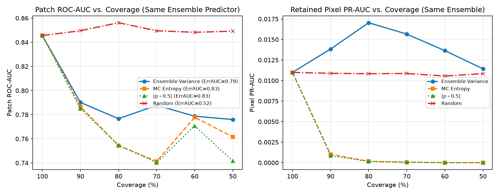

# Block 6 Item 3: Selective Prediction Redone (Unified 3-Seed Ensemble Predictor)

- **Fixed Predictor:** 3-Seed `IceUNet` Ensemble Mean (Full coverage: Patch ROC-AUC = `0.8456`, Pixel PR-AUC = `0.0110`)
- **Does any uncertainty score improve Patch ROC-AUC over full coverage?** `NO`
- **Does any uncertainty score improve Pixel PR-AUC over full coverage?** `YES`

> **Verdict:** Neither Ensemble Variance nor MC Entropy improves Patch ROC-AUC over full coverage (both drop as high-scoring uncertain patches are rejected); **uncertainty is not usable for selective rejection on this task.**

## 1. Summary: AURC & Error-Detection AUROC

| Rejection Score | AURC (Lower Better) | Error-Detection AUROC | 100% Patch AUC | 50% Patch AUC [Sub-block 95% CI] | 100% Px PR-AUC | 50% Px PR-AUC |
| :--- | :---: | :---: | :---: | :---: | :---: | :---: |
| **Ensemble Variance** | 0.1259 | 0.7879 | 0.8456 | 0.7759 `[0.680, 0.869]` | 0.0110 | 0.0114 |
| **MC Entropy** | 0.1096 | 0.8282 | 0.8456 | 0.7616 `[0.616, 0.844]` | 0.0110 | 0.0000 |
| **|p - 0.5|** | 0.1084 | 0.8310 | 0.8456 | 0.7416 `[0.640, 0.842]` | 0.0110 | 0.0000 |
| **Random** | 0.1917 | 0.5240 | 0.8456 | 0.8491 `[0.789, 0.899]` | 0.0110 | 0.0108 |

## 2. Full Coverage Curves (100% → 50%)

| Cov | Ens-Var AUC / F1 | MC-Ent AUC / F1 | `|p-0.5|` AUC / F1 | Random AUC / F1 | Ens-Var Px PR | MC-Ent Px PR | `|p-0.5|` Px PR |
| :---: | :---: | :---: | :---: | :---: | :---: | :---: | :---: |
| 100% | 0.846 / 0.530 | 0.846 / 0.530 | 0.846 / 0.530 | 0.846 / 0.530 | 0.0110 | 0.0110 | 0.0110 |
| 90% | 0.790 / 0.374 | 0.787 / 0.363 | 0.785 / 0.360 | 0.850 / 0.537 | 0.0138 | 0.0010 | 0.0009 |
| 80% | 0.777 / 0.287 | 0.754 / 0.206 | 0.755 / 0.206 | 0.856 / 0.551 | 0.0170 | 0.0002 | 0.0002 |
| 70% | 0.788 / 0.232 | 0.741 / 0.000 | 0.740 / 0.000 | 0.850 / 0.542 | 0.0157 | 0.0001 | 0.0001 |
| 60% | 0.779 / 0.132 | 0.778 / 0.000 | 0.771 / 0.000 | 0.848 / 0.534 | 0.0136 | 0.0000 | 0.0000 |
| 50% | 0.776 / 0.102 | 0.762 / 0.000 | 0.742 / 0.000 | 0.849 / 0.521 | 0.0114 | 0.0000 | 0.0000 |

