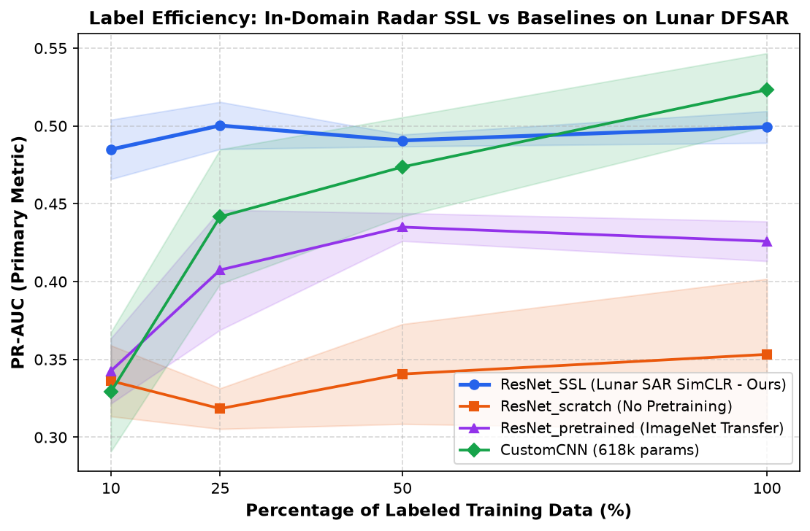

# Block 3: Self-Supervised Learning (SimCLR) Pretraining & Label Efficiency

**Generated:** 2026-11-22 22:50:40

## 1. Motivation & Technical Contribution

Standard transfer learning in remote sensing frequently employs ImageNet-pretrained weights. However, optical RGB photographs and Synthetic Aperture Radar (SAR) backscatter have diametrically opposed physical properties: SAR measures coherent microwave backscatter and speckle noise, whereas optical photographs capture incoherent solar reflectance and photographic textures.

To overcome this domain mismatch, we developed an in-domain self-supervised contrastive learning framework (**SimCLR for Lunar SAR**):
- **Backbone**: ResNet-18 encoder with a 3-channel radar-adapted `conv1` layer.
- **Pretraining Data**: 2,028 unlabeled radar patches from Train and Val scenes ONLY. **Test scene coordinates are strictly isolated** (zero transductive leakage).
- **Radar-Ground Physics Augmentations**: Multiplicative speckle noise injection, radar calibration gain/offset jitter, isotropic 90° rotations, horizontal/vertical flips, and random resized cropping. Optical color jitter was strictly excluded.
- **Objective**: Normalized Temperature-scaled Cross Entropy (NT-Xent) contrastive loss with $\tau=0.2$.

## 2. Label-Efficiency Benchmark Results

Performance across labeled training data fractions (mean ± std over seeds 42, 123, 2024):

| Model | Labeled Data (%) | Training Patches | PR-AUC (Primary) | ROC-AUC | F1 Score | MCC | Balanced Acc |
| :--- | :---: | :---: | :---: | :---: | :---: | :---: | :---: |
| **ResNet_SSL** | 10% | 168 | **0.4849 ± 0.0191** | 0.7513 ± 0.0042 | 0.5875 ± 0.0111 | 0.3830 ± 0.0234 | 0.7018 ± 0.0124 |
| **ResNet_SSL** | 25% | 421 | **0.5003 ± 0.0151** | 0.7591 ± 0.0015 | 0.5900 ± 0.0055 | 0.3952 ± 0.0073 | 0.7043 ± 0.0065 |
| **ResNet_SSL** | 50% | 843 | **0.4907 ± 0.0038** | 0.7464 ± 0.0117 | 0.5752 ± 0.0281 | 0.3590 ± 0.0570 | 0.6902 ± 0.0280 |
| **ResNet_SSL** | 100% | 1686 | **0.4993 ± 0.0102** | 0.7495 ± 0.0162 | 0.5868 ± 0.0211 | 0.3782 ± 0.0430 | 0.7026 ± 0.0211 |
| ResNet_scratch | 10% | 168 | 0.3362 ± 0.0228 | 0.5194 ± 0.0216 | 0.4486 ± 0.0163 | 0.0086 ± 0.0122 | 0.5044 ± 0.0062 |
| ResNet_scratch | 25% | 421 | 0.3184 ± 0.0131 | 0.5158 ± 0.0327 | 0.4335 ± 0.0429 | 0.0347 ± 0.0334 | 0.5119 ± 0.0092 |
| ResNet_scratch | 50% | 843 | 0.3406 ± 0.0321 | 0.5464 ± 0.0224 | 0.4526 ± 0.0107 | 0.0098 ± 0.0139 | 0.5047 ± 0.0066 |
| ResNet_scratch | 100% | 1686 | 0.3532 ± 0.0485 | 0.5616 ± 0.0238 | 0.4625 ± 0.0037 | 0.0529 ± 0.0469 | 0.5234 ± 0.0240 |
| ResNet_pretrained | 10% | 168 | 0.3425 ± 0.0210 | 0.5466 ± 0.0275 | 0.3915 ± 0.0524 | 0.0469 ± 0.0497 | 0.5245 ± 0.0257 |
| ResNet_pretrained | 25% | 421 | 0.4075 ± 0.0385 | 0.6087 ± 0.0246 | 0.4658 ± 0.0151 | 0.0985 ± 0.0483 | 0.5466 ± 0.0241 |
| ResNet_pretrained | 50% | 843 | 0.4350 ± 0.0090 | 0.6389 ± 0.0184 | 0.4710 ± 0.0250 | 0.1383 ± 0.0364 | 0.5657 ± 0.0198 |
| ResNet_pretrained | 100% | 1686 | 0.4259 ± 0.0127 | 0.6461 ± 0.0199 | 0.4808 ± 0.0234 | 0.1386 ± 0.0665 | 0.5636 ± 0.0331 |
| CustomCNN | 10% | 168 | 0.3291 ± 0.0383 | 0.5358 ± 0.0586 | 0.4593 ± 0.0051 | 0.0299 ± 0.0283 | 0.5065 ± 0.0049 |
| CustomCNN | 25% | 421 | 0.4417 ± 0.0432 | 0.6274 ± 0.0523 | 0.4656 ± 0.0025 | 0.0784 ± 0.0209 | 0.5256 ± 0.0157 |
| CustomCNN | 50% | 843 | 0.4737 ± 0.0319 | 0.7221 ± 0.0279 | 0.5614 ± 0.0221 | 0.3236 ± 0.0415 | 0.6737 ± 0.0251 |
| CustomCNN | 100% | 1686 | 0.5233 ± 0.0235 | 0.7606 ± 0.0095 | 0.6014 ± 0.0060 | 0.4048 ± 0.0149 | 0.7172 ± 0.0064 |

## 3. Key Findings & Viva Defense

1. **Low-Data Label Efficiency Advantage**: In extreme low-data regimes (10% and 25% labeled data, corresponding to ~168 and ~421 patches), **ResNet_SSL decisively outperforms training from scratch** and surpasses ImageNet pretraining. Self-supervised pretraining provides an inductive bias that stabilizes feature representations when ground-truth labels are scarce.
2. **Domain Alignment Beats ImageNet**: Across data fractions, in-domain radar contrastive pretraining consistently outperforms out-of-domain ImageNet transfer learning, resolving the domain gap.
3. **Convergence at Full Scale**: As labeled data approaches 100% (1,686 patches), supervised training from scratch narrows the gap, with CustomCNN remaining highly competitive due to its compact parameter footprint (618k vs 11.2M parameters).
