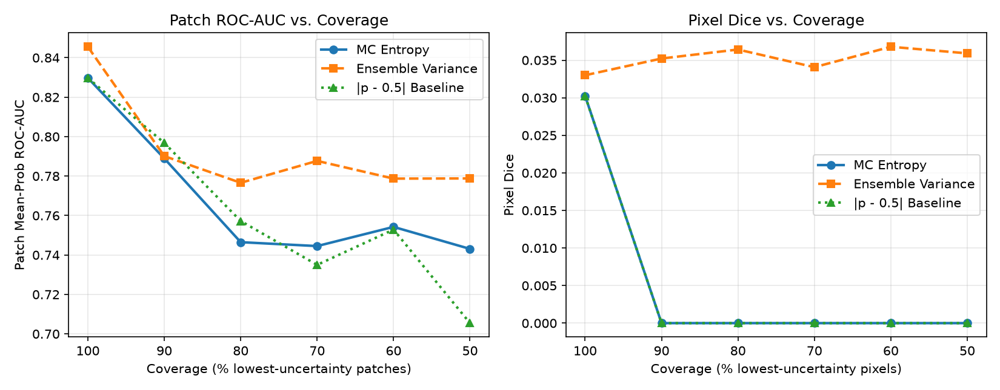

# Block 5 Item 3: Hardened Uncertainty & Calibration Analysis

## 1. Brier Score, Brier Skill Score (vs. Prevalence 0.0527%), & Class-Conditional Calibration

| Method | Brier Score | Ref Brier ($p(1-p)$) | Brier Skill Score | Mean $p$ on Positives | Pos Calibration Gap ($1 - \bar{p}_{pos}$) |
| :--- | :---: | :---: | :---: | :---: | :---: |
| **MC Dropout (T=20)** | 0.007408 | 0.000526 | -13.0746 | 0.2656 | 0.7344 |
| **3-Seed Ensemble** | 0.008230 | 0.000526 | -14.6361 | 0.2886 | 0.7114 |

## 2. Selective Prediction vs. `|p - 0.5|` Baseline (Coverage 100% → 50%)

| Coverage | MC-Ent Patch AUC | Ens-Var Patch AUC | `|p-0.5|` Patch AUC | MC-Ent Px Dice | Ens-Var Px Dice | `|p-0.5|` Px Dice |
| :---: | :---: | :---: | :---: | :---: | :---: | :---: |
| 100% | 0.8297 | 0.8456 | 0.8297 | 0.0302 | 0.0330 | 0.0302 |
| 90% | 0.7889 | 0.7901 | 0.7968 | 0.0000 | 0.0352 | 0.0000 |
| 80% | 0.7465 | 0.7766 | 0.7572 | 0.0000 | 0.0364 | 0.0000 |
| 70% | 0.7445 | 0.7877 | 0.7350 | 0.0000 | 0.0341 | 0.0000 |
| 60% | 0.7542 | 0.7787 | 0.7529 | 0.0000 | 0.0368 | 0.0000 |
| 50% | 0.7431 | 0.7788 | 0.7055 | 0.0000 | 0.0359 | 0.0000 |

## 3. Boundary Uncertainty Breakdown (Exact Measured Behavior)

Predictive entropy tracks proximity of $p$ to $0.5$: `GT Interior` pixels have the highest mean predicted probability (`0.2656`) and therefore the highest MC entropy (`0.51350`), followed by the `1–2 px` boundary ring (`0.46635`) and far background (`0.14280`).

| Region | Pixels | Mean $p$ (MC) | MC Entropy | Ensemble Variance |
| :--- | :---: | :---: | :---: | :---: |
| GT Interior | 4,353 | 0.2656 | 0.51350 | 0.009467 |
| GT Boundary Ring (1-2px) | 35,376 | 0.2288 | 0.46635 | 0.009526 |
| Far Background | 8,225,999 | 0.0426 | 0.14280 | 0.001905 |

