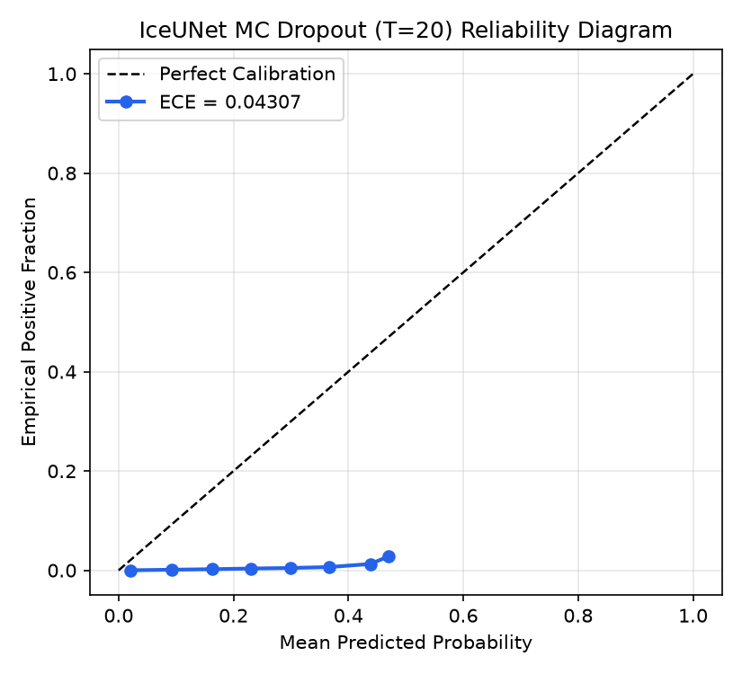
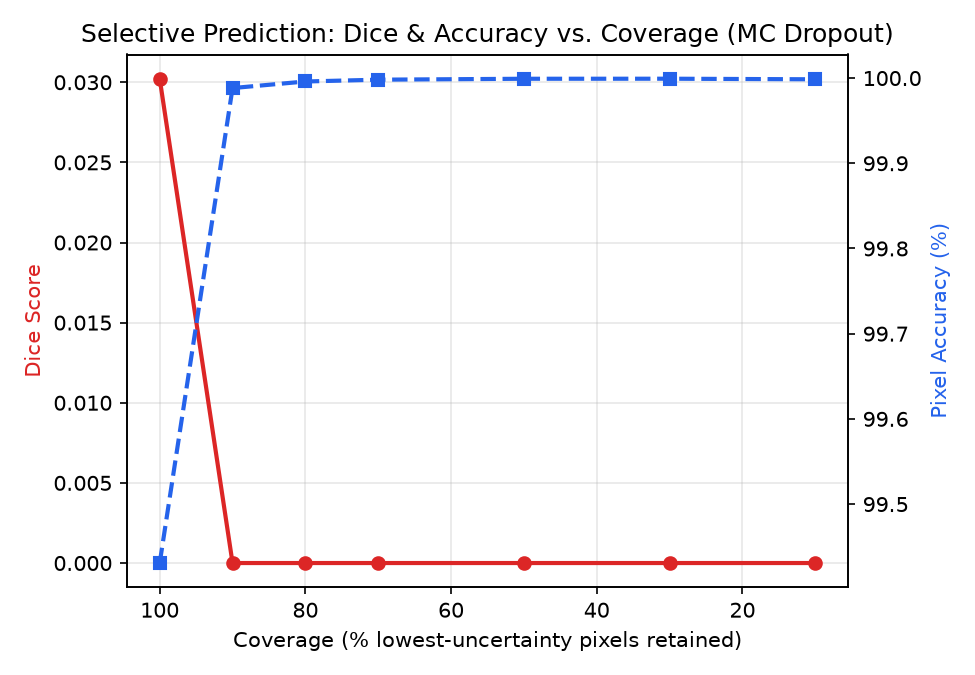

# Block 3a: Uncertainty Quantification & Geospatial Map Export

## 1. MC Dropout (T=20) vs. 3-Seed Deep Ensemble (Test Pixels)

| Method | Pixel PR-AUC | Pixel ROC-AUC | Dice (Val Th) | IoU (Val Th) | ECE | Mean Entropy | Mean Variance |
| :--- | :---: | :---: | :---: | :---: | :---: | :---: | :---: |
| **MC Dropout (T=20)** | 0.0094 | 0.9361 | 0.0302 | 0.0153 | 0.04307 | 0.14451 | 0.000073 |
| **3-Seed Ensemble** | 0.0110 | 0.9518 | 0.0334 | 0.0170 | 0.04794 | 0.15637 | 0.001942 |

## 2. Boundary Uncertainty Test (Measured, Not Assumed)

| Region | Pixel Count | MC Mean Entropy | MC Mean Variance | Ensemble Mean Entropy | Ensemble Mean Variance |
| :--- | :---: | :---: | :---: | :---: | :---: |
| GT Interior | 4,353 | 0.51384 | 0.000457 | 0.55762 | 0.009468 |
| GT Boundary Ring (1-2px) | 35,376 | 0.46674 | 0.000438 | 0.51221 | 0.009529 |
| Far Background | 8,225,999 | 0.14293 | 0.000071 | 0.15466 | 0.001904 |

## 3. Selective Prediction (Dice & Accuracy vs. Coverage)

| Coverage | Pixels Retained | Positive Pixels | Dice Score | Pixel Accuracy |
| :---: | :---: | :---: | :---: | :---: |
| 100% | 8,265,728 | 4,353 | 0.0302 | 99.431% |
| 90% | 7,439,155 | 873 | 0.0000 | 99.988% |
| 80% | 6,612,582 | 266 | 0.0000 | 99.996% |
| 70% | 5,786,009 | 110 | 0.0000 | 99.998% |
| 50% | 4,132,864 | 34 | 0.0000 | 99.999% |
| 30% | 2,479,718 | 19 | 0.0000 | 99.999% |
| 10% | 826,572 | 12 | 0.0000 | 99.999% |

## 4. Stitched Test-Strip Maps (QGIS Ready)

- **Slant-Range TIFF (azimuth × range + 676 shifted GCS_MOON GCPs):** `reports/real\maps\test_strips_prob_uncertainty_slant_range.tif`
- **TPS-Warped Moon South Polar Stereographic GeoTIFF (25 m/px):** `reports/real\maps\test_strips_prob_uncertainty_moon_stereo.tif`
- **Stitched Test-Strip Coverage:** `3,129,344` pixels across test strips `[0, 8, 15]`

