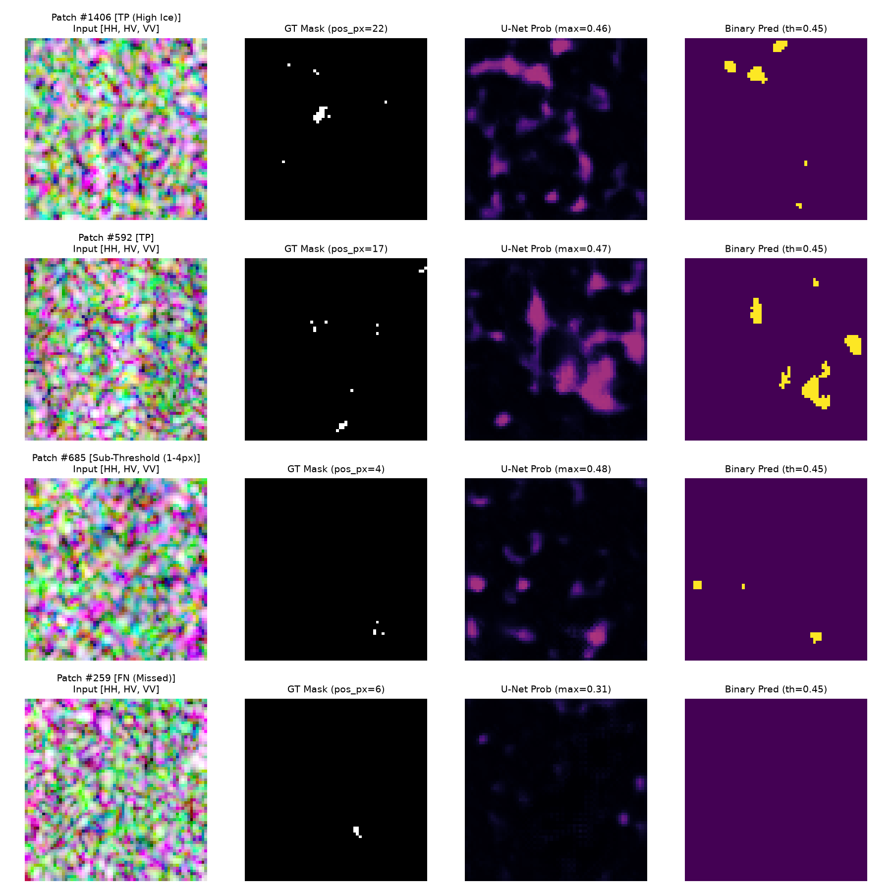

# Block 2: U-Net Pixel-Level Segmentation Report (Frozen Split `[90624, 319812]`)

- **Inputs:** Raw `[HH, HV, VV]` log-intensities only (anti-circularity)
- **Test Pixel Prevalence (PR-AUC baseline):** `0.0527%` (`4,353 / 8,265,728` pixels)

## 1. Pixel-Level Segmentation Benchmark (Test Set)

| Model | Pixel PR-AUC | Pixel ROC-AUC | Dice (Val Th) | IoU (Val Th) | Dice (Best Test Th) | IoU (Best Test Th) |
| :--- | :---: | :---: | :---: | :---: | :---: | :---: |
| Baseline: HV/HH Ratio | 0.0011 | 0.6960 | 0.0036 | 0.0018 | 0.0037 | 0.0019 |
| Baseline: Pixel LogReg | 0.0012 | 0.7023 | 0.0016 | 0.0008 | 0.0039 | 0.0020 |
| **IceUNet (3 seeds)** | 0.0093 ± 0.0003 | 0.9380 ± 0.0050 | 0.0266 ± 0.0045 | 0.0135 ± 0.0023 | 0.0266 ± 0.0045 | 0.0135 ± 0.0023 |

### Seed 42 Strip-Block Bootstrap 95% CIs & Per-Strip Breakdown

- **Pooled Pixel PR-AUC:** `0.0093` `[0.0091, 0.0097]`
- **Pooled Pixel Dice (Val Th=0.45):** `0.0295` `[0.0279, 0.0322]`

| Test Strip | Pos Px / Total Px | Pixel PR-AUC | Pixel ROC-AUC | Dice (Val Th) | IoU (Val Th) |
| :---: | :---: | :---: | :---: | :---: | :---: |
| Strip 0 | 1517 / 2,695,168 | 0.0096 | 0.9281 | 0.0322 | 0.0164 |
| Strip 8 | 1208 / 2,785,280 | 0.0100 | 0.9414 | 0.0264 | 0.0134 |
| Strip 15 | 1628 / 2,785,280 | 0.0097 | 0.9358 | 0.0309 | 0.0157 |

## 2. Patch-Level Aggregation vs. Classifiers (Identical Frozen Split)

| Model | Full ROC-AUC | Full PR-AUC (16.45%) | Full F1 (Val Th) | Full F1 (Best Test Th) | Clean ROC-AUC (Ablation) | Clean F1 (Ablation) |
| :--- | :---: | :---: | :---: | :---: | :---: | :---: |
| **IceUNet (agg: max_prob)** | 0.7219 | 0.2980 | 0.3527 | 0.3955 | 0.7939 | 0.5588 |
| **IceUNet (agg: mean_prob)** | 0.8335 | 0.5404 | 0.5185 | 0.5394 | 0.9035 | 0.6702 |
| **IceUNet (agg: px_count>=5)** | 0.7841 | 0.4304 | 0.3404 | 0.4469 | 0.8613 | 0.5392 |
| CustomCNN | 0.8379 | 0.5485 | 0.5216 | 0.5459 | 0.9103 | 0.7230 |
| ResNet_scratch | 0.8301 | 0.5203 | 0.5240 | 0.5269 | 0.8961 | 0.7042 |
| ResNet_pretrained | 0.7970 | 0.4529 | 0.4687 | 0.4864 | 0.8633 | 0.6840 |
| LogisticRegression | 0.8207 | 0.4976 | 0.5086 | 0.5089 | 0.8811 | 0.6699 |

## 3. Visual Overlays

